<p align="center">
	
</p>

<p align="center">
	
</p>

<p align="center">
	
	
	
	
</p>

<h1 align="center">Daymark</h1>

<p align="center">A calm, focused place to collect your tasks and keep your next step in view.</p>

## What it does

- Capture tasks, mark them complete, edit them, or remove them.
- Filter your list by all, active, and completed tasks.
- Clear completed work in one action.
- Keep tasks between visits with browser `localStorage`.
- Switch between sign-in and sign-up screens, with a responsive planner illustration.

> **Authentication status:** The sign-in and sign-up screens are a front-end preview. Email authentication and Google OAuth are not connected yet and require an auth provider and OAuth client configuration. Use **Continue without signing in** to open the todo app.

## Run locally

Requires Node.js 20.19+ and npm.

```bash
npm install
npm run dev
```

## Checks

| Command | Description |
| --- | --- |
| `npm run dev` | Start the Vite development server. |
| `npm run build` | Type-check and create a production build in `dist/`. |
| `npm run preview` | Serve the production build locally. |
| `npm run lint` | Run ESLint. |

## Built with

React 19 · TypeScript · Vite 8 · Tailwind CSS 4

## Deploy

The app can be deployed to [Vercel](https://vercel.com/). Use `npm run build` as the build command and `dist` as the output directory.

## License

No license file is currently included. Public visibility does not grant permission to reuse this project.